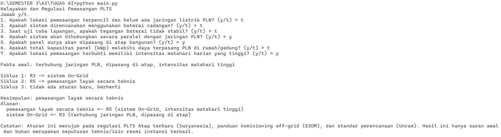
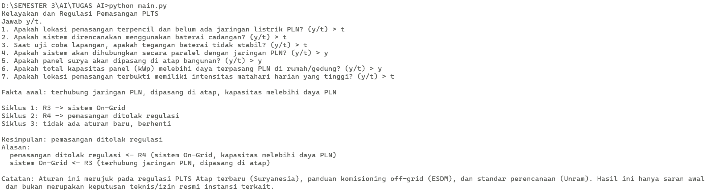
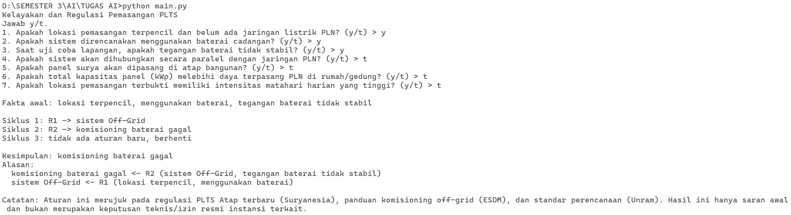
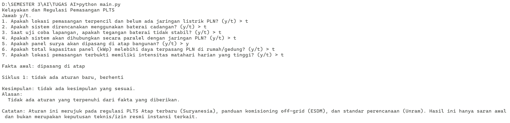

# SISTEM PAKAR PENENTUAN KELAYAKAN PEMASANGAN PLTS

## 1. Nama dan NIM

- **Nama:** I Putu Reynanda Putra Dynatha
- **NIM:** F1D02510115
- **Mata Kuliah:** Kecerdasan Buatan

## 2. Topik dan Cara Menjalankan Program

### Topik

Sistem Pakar Penentuan Kelayakan Pemasangan PLTS.

Program ini dibuat untuk membantu pengguna menentukan status kelayakan teknis atau perizinan dari rencana pemasangan panel surya berdasarkan beberapa kondisi, seperti ketersediaan jaringan PLN, penggunaan baterai, hasil uji tegangan, lokasi atap bangunan, batas daya listrik, dan intensitas matahari.

Sistem memberikan tiga kategori hasil, yaitu:

1. **Pemasangan Layak Secara Teknis:** Sistem On-Grid yang direncanakan memenuhi standar kapasitas dan didukung oleh intensitas matahari yang tinggi.
2. **Pemasangan Ditolak Regulasi:** Sistem On-Grid melanggar aturan karena kapasitas panel melebihi batas daya terpasang dari PLN.
3. **Komisioning Baterai Gagal:** Sistem Off-Grid gagal dalam tahap uji coba lapangan karena tegangan baterai tidak stabil.

Jika tidak ada aturan yang terpenuhi, sistem akan menampilkan bahwa tidak ada kesimpulan yang sesuai.

### Bahasa dan Versi

- Bahasa pemrograman: Python
- Versi: Python 3
- Format basis pengetahuan: JSON
- Metode inferensi: Forward Chaining

### File Program

- `main.py` : Berisi kode utama program dan proses Forward Chaining.
- `aturan.json` : Berisi fakta, pertanyaan, aturan IF-THEN, dan sumber pengetahuan.

### Cara Menjalankan Program

1. Pastikan Python 3 sudah terpasang di komputer.
2. Simpan file `main.py` dan `aturan.json` dalam satu folder.
3. Buka folder tersebut menggunakan Visual Studio Code.
4. Buka terminal pada folder program.
5. Jalankan perintah berikut:

```bash
python main.py
```

Jika perintah tersebut tidak berhasil, gunakan:

```bash
py main.py
```

6. Setelah program berjalan, jawab pertanyaan yang diberikan.
7. Masukkan `y` untuk jawaban Ya dan `t` untuk jawaban Tidak.
8. Setelah semua pertanyaan dijawab, program akan menampilkan hasil kelayakan pemasangan PLTS beserta alasan penentuannya.

## 3. Daftar Sumber dan Tabel Aturan

### A. Daftar Sumber

Sumber pengetahuan digunakan sebagai dasar dalam menyusun aturan pada sistem pakar. Sumber yang digunakan berasal dari situs pemerintah, pedoman universitas, dan artikel regulasi.

**Sumber 1**

- Judul: Field Testing Commissioning Guideline PLTS Off-Grid
- Penerbit: Kementerian ESDM RI
- URL: https://www.esdm.go.id/en/berita-unit/human-resource-development-agency-emr/ppsdm-kebtke-dan-ditjen-ebtke-lakukan-field-testing-commissioning-guideline-plts-off-grid

**Sumber 2**

- Judul: Perencanaan PLTS
- Penerbit: Universitas Mataram (Eprints)
- URL: https://eprints.unram.ac.id/9137/

**Sumber 3**

- Judul: Panduan Aturan PLTS Atap Terbaru
- Penerbit: Suryanesia
- URL: https://suryanesia.com/articles/panduan-aturan-plts-atap-terbaru

Tanggal akses seluruh sumber: 14 November 2026.

### B. Tabel Aturan (Rule Base)

Basis pengetahuan pada sistem ini terdiri dari lima aturan IF-THEN yang digunakan untuk menghasilkan kesimpulan.

| Kode | Aturan IF-THEN | Sumber |
|---|---|---|
| R1 | IF lokasi_terpencil OR menggunakan_baterai THEN sistem_Off_Grid | S1 |
| R2 | IF sistem_Off_Grid AND tegangan_baterai_tidak_stabil THEN komisioning_baterai_gagal | S1 |
| R3 | IF terhubung_jaringan_PLN AND dipasang_di_atap THEN sistem_On_Grid | S3 |
| R4 | IF sistem_On_Grid AND kapasitas_melebihi_daya_PLN THEN pemasangan_ditolak_regulasi | S3 |
| R5 | IF sistem_On_Grid AND intensitas_matahari_tinggi THEN pemasangan_layak_secara_teknis | S2 |

### C. Keterangan Fakta

- `lokasi_terpencil` : Lokasi pemasangan terpencil dan belum ada jaringan listrik PLN.
- `menggunakan_baterai` : Sistem direncanakan menggunakan baterai cadangan.
- `tegangan_baterai_tidak_stabil` : Saat uji coba lapangan, tegangan baterai tidak stabil.
- `terhubung_jaringan_PLN` : Sistem akan dihubungkan secara paralel dengan jaringan PLN.
- `dipasang_di_atap` : Panel surya akan dipasang di atap bangunan.
- `kapasitas_melebihi_daya_PLN` : Total kapasitas panel melebihi daya terpasang PLN.
- `intensitas_matahari_tinggi` : Lokasi pemasangan memiliki intensitas matahari harian yang tinggi.

### D. Keterangan Sumber pada Aturan

- S1: Kementerian ESDM RI.
- S2: Universitas Mataram.
- S3: Suryanesia.

## 4. Metode yang Dipilih dan Alasannya

Metode inferensi yang digunakan dalam sistem pakar ini adalah **Forward Chaining (FC)**.

Forward Chaining merupakan metode penalaran yang dimulai dari fakta atau kondisi awal yang diberikan oleh pengguna. Fakta tersebut kemudian dicocokkan dengan aturan yang tersedia sampai sistem mendapatkan kesimpulan.

Metode Forward Chaining dipilih karena sesuai dengan cara kerja program. Pengguna memberikan jawaban terlebih dahulu, kemudian sistem memproses jawaban tersebut untuk menentukan status kelayakan pemasangan PLTS.

### Langkah Kerja Forward Chaining

1. Pengguna menjawab pertanyaan yang diberikan oleh program.
2. Jawaban pengguna disimpan sebagai fakta.
3. Sistem mencocokkan fakta dengan aturan yang terdapat dalam file `aturan.json`.
4. Jika kondisi suatu aturan terpenuhi, sistem menghasilkan fakta atau kesimpulan baru.
5. Fakta baru dapat digunakan untuk memenuhi aturan berikutnya.
6. Proses pencocokan dilakukan sampai tidak ada aturan baru yang dapat dijalankan.
7. Sistem menampilkan hasil akhir berupa kelayakan pemasangan beserta alasan penentuannya.

### Contoh Proses Forward Chaining

Misalnya pengguna memberikan fakta berikut:

- `terhubung_jaringan_PLN` = Ya
- `dipasang_di_atap` = Ya
- `kapasitas_melebihi_daya_PLN` = Ya

Proses penalarannya:

1. Fakta `terhubung_jaringan_PLN` dan `dipasang_di_atap` memenuhi kondisi pada aturan R3 sehingga menghasilkan `sistem_On_Grid`.
2. Fakta `sistem_On_Grid` dan `kapasitas_melebihi_daya_PLN` memenuhi aturan R4.
3. Sistem menghasilkan kesimpulan `pemasangan_ditolak_regulasi`.

Dengan demikian, hasil akhir dari contoh tersebut adalah **Pemasangan Ditolak Regulasi**.

Metode ini tidak menggunakan rumus perhitungan numerik karena proses penalarannya dilakukan dengan mencocokkan fakta terhadap aturan IF-THEN.

## 5. Tiga Kasus Uji dan Screenshot

Pengujian dilakukan untuk mengetahui apakah sistem dapat memberikan kesimpulan sesuai dengan fakta dan aturan yang telah dibuat. Selain tiga pengujian kategori kelayakan, ditambahkan satu pengujian ketika tidak ada aturan yang terpenuhi.

### Kasus 1

**Kondisi yang dimasukkan:**

| Pertanyaan | Jawaban |
|---|---|
| Lokasi pemasangan terpencil dan belum ada jaringan PLN? | Tidak |
| Sistem direncanakan menggunakan baterai cadangan? | Tidak |
| Saat uji coba lapangan, tegangan baterai tidak stabil? | Tidak |
| Sistem dihubungkan secara paralel dengan jaringan PLN? | Ya |
| Panel surya akan dipasang di atap bangunan? | Ya |
| Total kapasitas panel melebihi daya terpasang PLN? | Tidak |
| Lokasi pemasangan memiliki intensitas matahari tinggi? | Ya |

**Hasil:** Pemasangan Layak Secara Teknis.

**Alasan:** Terhubung jaringan PLN dan dipasang di atap memicu R3 (Sistem On-Grid). Sistem On-Grid didukung intensitas matahari tinggi memenuhi aturan R5.

**Screenshot hasil pengujian:**



### Kasus 2

**Kondisi yang dimasukkan:**

| Pertanyaan | Jawaban |
|---|---|
| Lokasi pemasangan terpencil dan belum ada jaringan PLN? | Tidak |
| Sistem direncanakan menggunakan baterai cadangan? | Tidak |
| Saat uji coba lapangan, tegangan baterai tidak stabil? | Tidak |
| Sistem dihubungkan secara paralel dengan jaringan PLN? | Ya |
| Panel surya akan dipasang di atap bangunan? | Ya |
| Total kapasitas panel melebihi daya terpasang PLN? | Ya |
| Lokasi pemasangan memiliki intensitas matahari tinggi? | Tidak |

**Hasil:** Pemasangan Ditolak Regulasi.

**Alasan:** Terhubung jaringan PLN dan dipasang di atap memicu R3 (Sistem On-Grid). Karena kapasitas panel melebihi batas, kondisi tersebut memenuhi aturan R4.

**Screenshot hasil pengujian:**



### Kasus 3

**Kondisi yang dimasukkan:**

| Pertanyaan | Jawaban |
|---|---|
| Lokasi pemasangan terpencil dan belum ada jaringan PLN? | Ya |
| Sistem direncanakan menggunakan baterai cadangan? | Ya |
| Saat uji coba lapangan, tegangan baterai tidak stabil? | Ya |
| Sistem dihubungkan secara paralel dengan jaringan PLN? | Tidak |
| Panel surya akan dipasang di atap bangunan? | Tidak |
| Total kapasitas panel melebihi daya terpasang PLN? | Tidak |
| Lokasi pemasangan memiliki intensitas matahari tinggi? | Tidak |

**Hasil:** Komisioning Baterai Gagal.

**Alasan:** Lokasi terpencil atau menggunakan baterai memicu R1 (Sistem Off-Grid). Tegangan baterai yang tidak stabil memenuhi aturan R2.

**Screenshot hasil pengujian:**



### Kasus 4

**Kondisi yang dimasukkan:**

Semua pertanyaan dijawab Tidak.

**Hasil:** Tidak ada kesimpulan yang sesuai.

**Alasan:** Tidak ada fakta yang memenuhi kondisi aturan sehingga sistem tidak menghasilkan kesimpulan kelayakan pemasangan.

**Screenshot hasil pengujian:**



## 6. Batas Keberlakuan Sistem

Sistem pakar ini menggunakan pengetahuan yang disusun berdasarkan sumber dari Kementerian ESDM RI, Universitas Mataram, dan Suryanesia mengenai pedoman kelayakan dasar PLTS. Sistem ditujukan untuk membantu pengguna menentukan kelayakan pemasangan berdasarkan kondisi jaringan PLN, baterai, daya listrik, letak pemasangan, dan intensitas matahari. Sistem hanya dapat memberikan hasil berdasarkan fakta dan aturan yang telah dimasukkan ke dalam basis pengetahuan. Oleh karena itu, hasil yang diberikan merupakan saran atau rekomendasi untuk membantu pengguna dalam perencanaan awal, bukan keputusan perizinan akhir yang harus selalu diikuti. Pengguna tetap perlu mempertimbangkan konsultasi dengan instansi kelistrikan terkait.

## 7. Penggunaan Alat Bantu AI

Dalam proses pembuatan tugas ini, AI digunakan sebagai alat bantu untuk memahami konsep sistem pakar, menyusun aturan IF-THEN, membantu pembuatan kode program Python, serta menyusun dokumentasi README.

Hasil yang diberikan oleh AI kemudian diperiksa dan disesuaikan kembali agar sesuai dengan kebutuhan tugas. Program dan aturan yang digunakan juga dipelajari kembali agar dapat dipahami dan dijalankan dengan baik.
